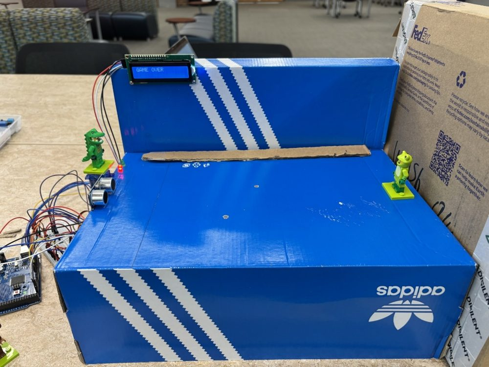
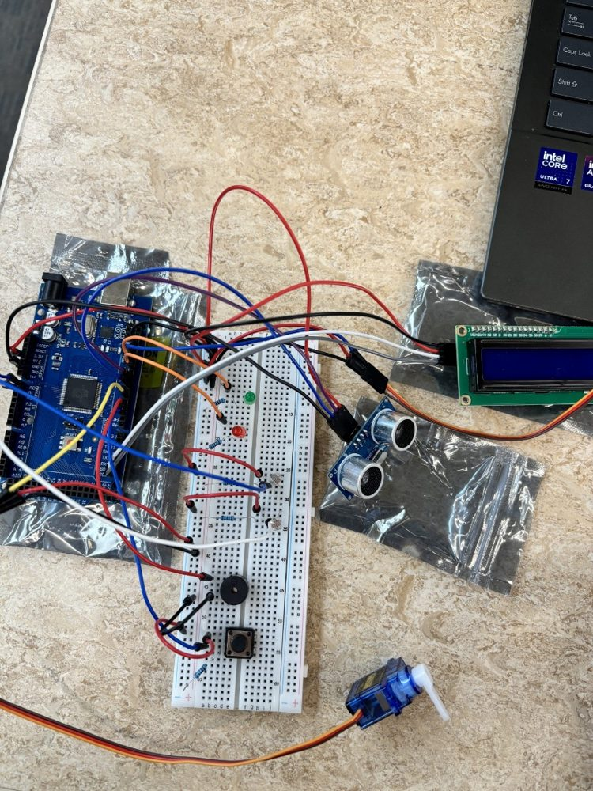
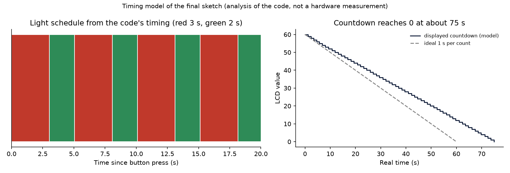

# Red Light, Green Light: Arduino Mega Sensor and Actuator Game

A physical version of the "Red Light, Green Light" game from *Squid Game*, built on an Arduino Mega 2560. A doll figure turns on a servo and a red/green light signals when players may move. An ultrasonic sensor detects movement during red, two photoresistors act as landmines, a second servo "sweeps" an eliminated player off the field, and an LCD shows the countdown and the result.

Final project for CPE 4010 (Sensors, Actuators, and Integration), Kennesaw State University, May 2026. Team of two: **Ethan Welsh** and **Enzo Sidibe** (instructor: Dr. Wang).



*The assembled game field (photo from the team's project report).*

## Engineering problem

Integrate several sensors and actuators into one real-time game: keep a light and doll-servo schedule, detect movement with a distance sensor, detect "steps" with light sensors, and end the game correctly on movement, a landmine, reaching the finish, or time-out.

## Components

| Component | Role | Pin (from the final sketch) |
|---|---|---|
| Arduino Mega 2560 | Controller | n/a |
| Green and red LEDs | Show when players may move | 11, 10 (220 Ω resistors) |
| Servo 1 (doll) | Turns the doll: 180° facing players on red, 0° on green | 12 |
| Servo 2 (sweep) | Swings 90° → 0° → 90° to remove an eliminated player | 5 |
| HC-SR04-style ultrasonic sensor | Detects movement and the finish | trig 8, echo 7 |
| Photoresistors ×2 (10 kΩ pull-downs) | Landmines | A0, A1 |
| 16×2 I²C LCD (address 0x27) | Countdown, `GAME OVER`, `YOU WIN!` | I²C |
| Buzzer | 1 kHz tone on red, 5 kHz on green, 1 kHz at start | 3 |
| Push button (10 kΩ pull-down) | Starts the game | 2 |



*Breadboard wiring (photo from the project report).*

## How it works

State and rules in `firmware/red_light_green_light/red_light_green_light.ino`:

1. **Start:** the button starts a 60-count countdown and the game begins on **red** (3 s).
2. **Lights:** red lasts 3 s, green 2 s, alternating. Red turns the doll servo to 180° with a 1 kHz tone; green turns it to 0° with a 5 kHz tone.
3. **Movement (red only):** the distance read at the start of each loop pass is compared with a second read taken after the loop's delay. A change of 2.5 cm or more eliminates the player: the sweep servo swings and the LCD shows `GAME OVER`.
4. **Win:** a distance of 5 cm or less ends the game with `YOU WIN!`.
5. **Landmines:** each photoresistor arms when its reading is 600 or below. If a later reading is at least 10 % higher (a foot steps on, then off), the player is eliminated the same way.
6. **Time-out:** when the countdown reaches 0 the LCD shows `GAME OVER`.

## Team contributions

From the project report's workload table:

| Member | Responsibility |
|---|---|
| Ethan Welsh | Push button to start the game, red/green light states, doll servo, buzzer tones, LCD display |
| Enzo Sidibe | Sweep-servo code for game over, winning logic, ultrasonic-sensor code, photoresistor landmine code, and troubleshooting to make the parts work together |

## Result

The team report states that all parts of the system were functional and that the ultrasonic sensor showed sensitivity issues that produced errors in some games but not others. No recorded logs or test data are included here.

## Analysis of the final code

The sketch in this repository is the final submitted code, unchanged (it matches the code printed in the report). The analysis below comes from reading the code and from `tools/game_model.py`, a host-side model that reads its constants from the sketch. **It is a model of the code's timing, not a measurement.** A stopwatch on the real board would confirm or correct it.

```bash
pip install -r requirements.txt
pytest -q                     # 18 tests
python tools/make_figures.py  # regenerates results/
```



| Finding | Basis | Effect |
|---|---|---|
| The lights follow the intended schedule closely: red ≈ 3.03 s, green ≈ 2.02 s | Model: checks run once per loop pass (about 0.61 s while red, 0.40 s while green) | Fine for gameplay |
| The 60-count countdown takes about **75 s** of real time | `lastSecond` is reset to the current time instead of advanced by 1000 ms, and the one-second check runs only once per pass, so each displayed second lasts about 1.2 s | The LCD timer runs about 25 % slow; fix with `lastSecond += 1000` or by removing the blocking delays |
| The slowest movement the sensor can see is about **6 cm/s** | The "first" distance is read before `delay(400)` and the "second" after it, so the 2.5 cm threshold applies over about 0.4 s; the later `delay(200)` adds no sampling | A player creeping slowly can pass |
| "No echo" reads as **YOU WIN** | `pulseIn()` returns 0 on timeout, and `0 <= 5` satisfies the win test | A player outside the sensor's view, or an aimed-away sensor, can end the game as a win; consistent with the report's sensitivity note |
| Blocking `delay()` calls and a 1 s `pulseIn` timeout | Code reading | The loop can stall; a non-blocking design with `millis()` timers would fix it |

## Development notes

An earlier working copy of the sketch used a different pin map and an `if (redpin = HIGH)` test, which assigns to the pin variable instead of comparing. The final code replaced that mechanism with the measured-distance logic above. This is noted as an example of why `-Wall` and a quick read for `=` versus `==` are worth doing.

## Known limitations

- No logged test data; the result statement comes from the team report.
- Thresholds (2.5 cm, 5 cm, 600, 1.10) are hard-coded and were tuned by hand for the team's field.
- The sweep is the same routine pasted three times; a function would shorten the code.

## Future work

- Non-blocking loop with `millis()` timers and a fixed-rate sensor read.
- Median-of-three distance filtering, treat a 0 reading as "no echo", and require a valid reading before declaring a win.
- Log movement and landmine events over serial to tune thresholds with data.

## Preparation note

The original sketch and the report are the team's coursework. This README, the host-side model, the tests and the figure were produced during portfolio preparation with AI assistance (Claude).

## License

MIT for the original code (`LICENSE`).
